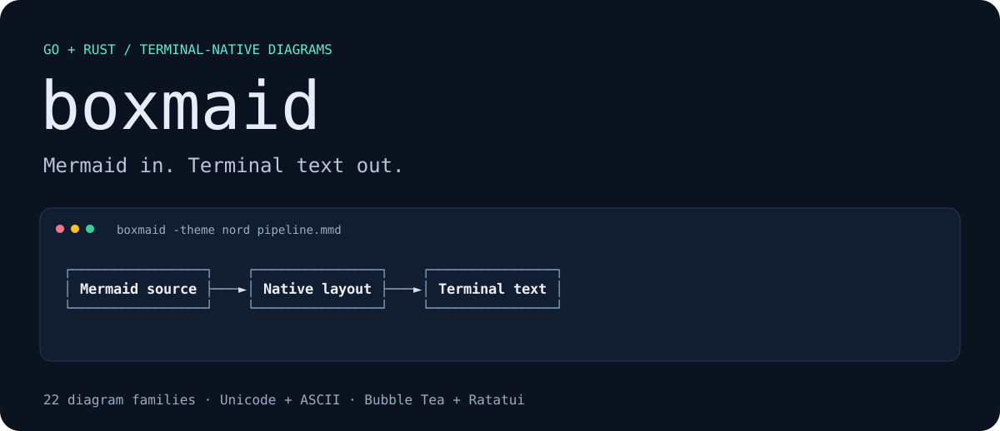
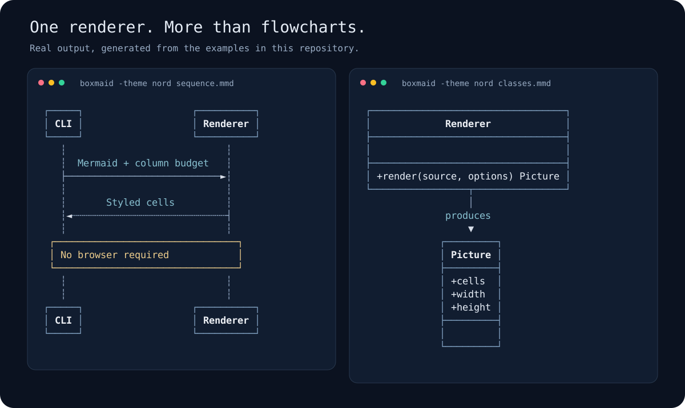

# boxmaid

**Render Mermaid as terminal text in Go and Rust.** Use it as a CLI, embed it in a library, or put it in a Bubble Tea or Ratatui app. No browser, JavaScript runtime, or image protocol required.



[Quick start](#how-do-i-try-it) · [Go](#how-do-i-use-the-go-library) · [Rust](#how-do-i-use-the-rust-crate) · [Agent guide](docs/agents.md) · [Syntax coverage](docs/syntax.md) · [Architecture](docs/architecture.md)

[](https://github.com/rickthegreatest/boxmaid/actions/workflows/ci.yml)
[](https://github.com/rickthegreatest/boxmaid/releases/latest)
[](https://pkg.go.dev/github.com/rickthegreatest/boxmaid)
[](LICENSE)

## What does it do?

Boxmaid turns Mermaid source into Unicode box-drawing characters or plain ASCII. It provides:

- **22 diagram families**, with explicitly documented syntax coverage.
- **Width-aware layout:** label wrapping and alternate directions when diagrams are too wide.
- **Cells with semantic roles:** style nodes, edges, labels, and clusters in your own UI.
- **Native integrations:** a pannable Bubble Tea model and a Ratatui widget.
- **Shared output fixtures:** the Go and Rust implementations are checked against the same text.

The Go core has no third-party dependencies. The Rust core depends on `regex`; Ratatui is optional. The CLI and rendering libraries work offline. `-live` only constructs a URL; opening it is up to you.

## How do I try it?

Install the Go CLI:

```sh
go install github.com/rickthegreatest/boxmaid/cmd/boxmaid@latest
```

Or download a [prebuilt binary](https://github.com/rickthegreatest/boxmaid/releases/latest) for Linux, macOS, or Windows. To build the Rust CLI directly from the release:

```sh
cargo install --git https://github.com/rickthegreatest/boxmaid --tag v0.1.0 --locked boxmaid
```

From a checkout, use `go run ./cmd/boxmaid docs/examples/pipeline.mmd` or `cargo run --manifest-path rust/Cargo.toml -- docs/examples/pipeline.mmd`.

Both install a command named `boxmaid` and use the same flags. Go core/CLI requires Go 1.22+, Bubble Tea integration Go 1.24+, and Rust 1.88+.

```sh
printf 'flowchart LR\n  A[Source] --> B[Layout] --> C[Text]\n' | boxmaid
```

```text
┌────────┐    ┌────────┐    ┌──────┐
│ Source ├───►│ Layout ├───►│ Text │
└────────┘    └────────┘    └──────┘
```

## How do I render files, Markdown, or CI output?

Put flags before filenames. Without a filename, the CLI reads piped stdin. Use `-` for stdin explicitly, or `--` before a filename beginning with `-`.

```sh
boxmaid diagram.mmd                         # fit to an interactive terminal
boxmaid -w 80 -ascii diagram.mmd             # plain ASCII, 80-column budget
boxmaid -theme nord diagram.mmd              # default, mono, dracula, nord
boxmaid -md README.md                        # replace fenced Mermaid with fenced text
boxmaid -w 80 -color never diagram.mmd        # reproducible log/agent output
boxmaid -w 80 -require-fit diagram.mmd        # fail instead of printing an oversized diagram
boxmaid -live diagram.mmd                    # print a mermaid.live fallback URL
boxmaid -list                               # supported header spellings
boxmaid -version
boxmaid -help
```

Colour defaults to interactive terminals only. Non-empty `NO_COLOR` disables automatic colour; `-color always|never` overrides it. Markdown replacement always emits plain text and preserves blocks it cannot render.

| Exit code | Meaning |
|---|---|
| `0` | Success; width fitting may still be best-effort |
| `1` | A diagram could not render, or output could not be written |
| `2` | Invalid arguments or unreadable input |
| `3` | A diagram exceeded the budget with `-require-fit`; that diagram is not printed |

Drawings go to stdout; diagnostics go to stderr. With several files, processing continues after input/render errors. Already-rendered files remain on stdout if a later file fails.

## How do I use the Go library?

```sh
go get github.com/rickthegreatest/boxmaid
```

```go
import (
    "fmt"
    "github.com/rickthegreatest/boxmaid"
)

func draw(src string) error {
    pic, err := boxmaid.Render(src, boxmaid.Options{Width: 80})
    if err != nil {
        return err
    }
    fmt.Println(pic)                         // plain text; title is in pic.Title
    fmt.Println(pic.ANSI(boxmaid.NordTheme))  // optional ANSI styling
    return nil
}
```

`Picture` exposes `W`, `H`, and `Cells`. Each cell has a `Role`, `Color`, and `Bold` flag. `Theme.CellStyle` resolves styling for custom adapters. `ReplaceMermaid` transforms Markdown; `LiveURL` creates a fallback link. An unknown header returns `*UnsupportedError`; empty content returns `ErrEmpty`; malformed source encoding returns `ErrInvalidUTF8`.

For **Bubble Tea**, add `github.com/rickthegreatest/boxmaid/tui`:

```go
m := tui.New(src)
m.SetSize(width, height)                     // call when allocated space changes
m.SetStyles(tui.DefaultStyles())             // immediately restyle the current picture
// In Update: m, cmd = m.Update(msg)
// In View:   m.View()
```

The model supports arrows, `hjkl`, page keys, Home/End, and mouse-wheel panning. Its view keeps the allocated height. See the [runnable viewer](tui/examples/viewer/main.go).

## How do I use the Rust crate?

```sh
cargo add boxmaid
# For a Ratatui widget:
cargo add boxmaid --features ratatui
```

```rust
let pic = boxmaid::render(src, &boxmaid::Options { width: 80, ascii: false })?;
println!("{pic}");                           // plain text; title is in pic.title
println!("{}", pic.ansi(&boxmaid::Theme::nord()));
```

With the `ratatui` feature, `&Picture` is a `Widget`. Use `Diagram` for themes and scrolling:

```rust
frame.render_widget(
    boxmaid::Diagram::new(&pic).theme(boxmaid::Theme::nord()).scroll(0, top),
    area,
);
```

See the [runnable Ratatui viewer](rust/examples/ratatui_viewer.rs). Call `render` again when the column budget changes; scrolling a widget does not repeat layout.

## Which diagrams can I render?

| Family | Mermaid header |
|---|---|
| Flowchart | `flowchart`, `graph`, `flowchart-elk` |
| Sequence | `sequenceDiagram` |
| Class | `classDiagram`, `classDiagram-v2` |
| State | `stateDiagram`, `stateDiagram-v2` |
| Entity relationship | `erDiagram` |
| C4 | `C4Context`, `C4Container`, `C4Component`, `C4Dynamic`, `C4Deployment` |
| Gantt, pie, journey | `gantt`, `pie`, `journey` |
| Timeline, mindmap, git graph | `timeline`, `mindmap`, `gitGraph` |
| Quadrant, XY chart | `quadrantChart`, `xychart-beta`, `xychart` |
| Kanban, packet | `kanban`, `packet-beta`, `packet` |
| Sankey, radar, treemap | `sankey-beta`, `radar-beta`, `treemap-beta` (also without `-beta`) |
| Requirement | `requirementDiagram` |
| Architecture, block | `architecture-beta`, `block-beta` (also without `-beta`) |



Images are generated from [these Mermaid examples](docs/examples/) by `go run ./internal/artwork`. They show actual diagram geometry and text, with presentation styling for this page.

## What are the compatibility limits?

**This is a selective Mermaid renderer, not a Mermaid validator or a pixel-equivalent replacement.** Read [the syntax reference](docs/syntax.md) before relying on a particular construct.

- Unrecognized statements within a supported diagram are generally skipped. Successful rendering does not prove that all source semantics were preserved.
- Some visual charts use terminal-friendly representations: pie, radar, and Sankey data become bars or lists. Architecture edge-side hints influence overall direction, not exact attachment sides.
- Width fitting is best-effort. If nothing fits, the narrowest attempt is returned. Compare `pic.W` / `pic.w` with your budget, or use CLI `-require-fit`.
- `Width: 0` / `width: 0` means unlimited in the library. In the CLI, zero uses detected terminal width when interactive and unlimited width when piped.
- Width measurements cover common CJK, emoji, ZWJ sequences, flags, and combining marks. Terminal/font Unicode behavior can differ.
- Markdown transformation handles backtick and tilde fences, including longer outer fences and CRLF. It is not a complete Markdown parser; blockquote-prefixed fences are left alone.

## How should an agent use this repository?

Start with [AGENTS.md](AGENTS.md) for repository instructions or [the agent integration guide](docs/agents.md) for commands, API contracts, failure handling, and fallback recipes. [llms.txt](llms.txt) is a short documentation index.

For deterministic CLI output, use an explicit width and colour policy:

```sh
boxmaid -w 80 -color never -require-fit diagram.mmd
```

Check the exit code and stderr. Never treat a rendered diagram or `Supported`/`supported` as proof of complete Mermaid compatibility. Preserve the original source when you also need a browser fallback.

## How is the project tested and maintained?

The graph-based renderers share a graph model, layered layout, and drawing canvas. Both languages use shared fixtures; CI also compares their CLI output at several widths. See [architecture](docs/architecture.md) for the module map and [CONTRIBUTING.md](CONTRIBUTING.md) for the full check sequence.

```sh
go test ./... ./tui/...
cargo test --manifest-path rust/Cargo.toml --all-features
go run ./internal/artwork -check
```

Release procedure and package ordering are documented in [docs/releasing.md](docs/releasing.md). Changes are listed in [CHANGELOG.md](CHANGELOG.md).

## What is the license?

[MIT](LICENSE).
