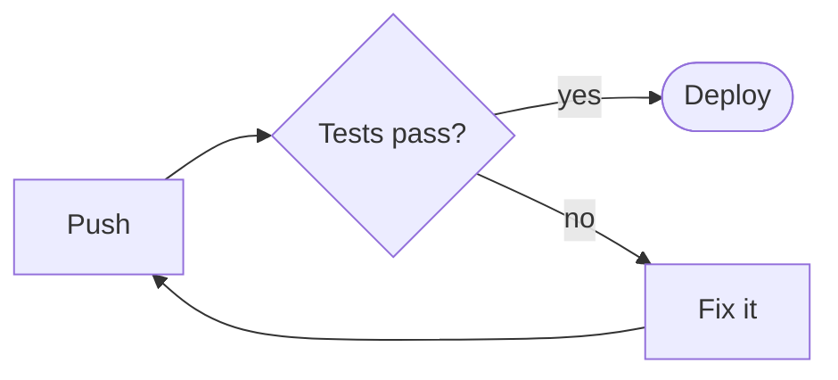

# boxmaid

**[Mermaid](https://mermaid.js.org) diagrams for the terminal**, in Go and in Rust.

boxmaid reads Mermaid source and draws it with Unicode box-drawing characters (or plain ASCII). It lays the diagram out so edges don't run through nodes or over each other, and fits it to the width you have. It's for TUIs, CLIs, `man`-style docs, CI logs, and any other place a browser can't go.



```
                ╱───────────────╲            ╭────────╮
                │               │  ┌───yes──►│ Deploy │
                │               │  │         ╰────────╯
┌──────┐  ┌────►│  Tests pass?  ├──┤
│      │  │     │               │  │         ┌────────┐
│      │◄─┼┐    │               │  │         │        │
│ Push ├──┘│    ╲───────────────╱  └───no───►│        │
│      │   │                                 │ Fix it │
│      │   └─────────────────────────────────┤        │
└──────┘                                     │        │
                                             └────────┘
```

```
┌───────┐       ┌─────┐
│ Alice │       │ Bob │
└───────┘       └─────┘
    ┆              ┆
    ┆  Hello Bob   ┆
    ├─────────────►┆
    ┆              ┆
    ┆  Hi Alice    ┆
    ┆◄┄┄┄┄┄┄┄┄┄┄┄┄┄┤
    ┆              ┆
    ┆              ┆
┌───────┐       ┌─────┐
│ Alice │       │ Bob │
└───────┘       └─────┘
```

```
Pets

Dogs  █████████████████████████████ 79.4%
Cats  ██████ 17.5%
Rats  █ 3.1%
```

## Why

Mermaid renders in a browser. Terminal tools either show the source or shell out to a headless browser to make an image, which most terminals can't display. boxmaid draws the diagram itself, as text, with no dependencies.

- **Real layout.** It uses a layered (Sugiyama) layout with cycle breaking, crossing reduction, edge routing on separate tracks, nested subgraphs with ports, self loops, and edge labels on their own rank.
- **Fits the width.** It wraps labels tighter and, if needed, turns a wide left-to-right chart top to bottom.
- **Colour your way.** Every cell carries a `Role` (node, edge, arrow, label, cluster…) and any `classDef`/`style` colour. You can style it with your own theme, or use the built-in ANSI themes (`default`, `mono`, `dracula`, `nord`).
- **Unicode-correct.** It measures widths for East Asian characters, emoji (including ZWJ sequences and flags) and combining marks. A pure-ASCII mode transliterates everything else.
- **Two languages, one output.** The Go module and the Rust crate draw the same input to the same bytes. Both are checked against one shared set of golden files.

## Supported diagrams

| Diagram | Headers |
|---|---|
| Flowchart | `flowchart`, `graph`, `flowchart-elk` |
| Sequence | `sequenceDiagram` |
| Class | `classDiagram`, `classDiagram-v2` |
| State | `stateDiagram`, `stateDiagram-v2` |
| Entity relationship | `erDiagram` |
| C4 | `C4Context`, `C4Container`, `C4Component`, `C4Dynamic`, `C4Deployment` |
| Gantt | `gantt` |
| Pie | `pie` |
| User journey | `journey` |
| Timeline | `timeline` |
| Mindmap | `mindmap` |
| Git graph | `gitGraph` |
| Quadrant chart | `quadrantChart` |
| XY chart | `xychart-beta`, `xychart` |
| Kanban | `kanban` |
| Packet | `packet-beta`, `packet` |
| Sankey | `sankey-beta`, `sankey` |
| Radar | `radar-beta`, `radar` |
| Treemap | `treemap-beta`, `treemap` |
| Requirement | `requirementDiagram` |
| Architecture | `architecture-beta`, `architecture` |
| Block | `block-beta`, `block` |

[docs/syntax.md](docs/syntax.md) lists what each one understands. For anything that can't be drawn as text (such as `zenuml`), you get an `Unsupported` error. You can then link to [mermaid.live](https://mermaid.live) with `LiveURL` / `live_url` instead.

## Command line

```sh
go install github.com/boxmaid/boxmaid/cmd/boxmaid@latest   # or: cargo install boxmaid

boxmaid diagram.mmd            # draw, fitted to the terminal
boxmaid < diagram.mmd          # from standard input
boxmaid -md README.md          # draw every ```mermaid block of a Markdown file
boxmaid -w 80 -ascii x.mmd     # 80 columns, plain ASCII
boxmaid -theme nord x.mmd      # colour theme (default, mono, dracula, nord)
boxmaid -live x.mmd            # print a mermaid.live link
boxmaid -list                  # the diagram types boxmaid draws
```

Colour is used when the output is a terminal and `NO_COLOR` isn't set. `-color always|never` overrides that.

## Go

```sh
go get github.com/boxmaid/boxmaid
```

```go
pic, err := boxmaid.Render(src, boxmaid.Options{Width: 100})
if err != nil {
	var u *boxmaid.UnsupportedError
	if errors.As(err, &u) {
		fmt.Println("open in a browser:", boxmaid.LiveURL(src))
	}
	return err
}
fmt.Println(pic)                          // plain text
fmt.Println(pic.ANSI(boxmaid.NordTheme))  // coloured

for _, row := range pic.Cells {           // or colour it yourself
	for _, c := range row { _ = c.Role; _ = c.Color; _ = c.Bold }
}

// Replace every ```mermaid block of a Markdown document with its drawing.
out := boxmaid.ReplaceMermaid(markdown, boxmaid.Options{Width: 80})
```

The core module has no dependencies.

### Bubble Tea

`github.com/boxmaid/boxmaid/tui` adds [lipgloss](https://github.com/charmbracelet/lipgloss) styling and a scrollable [Bubble Tea](https://github.com/charmbracelet/bubbletea) model:

```go
lines := tui.Lines(pic, tui.DefaultStyles())   // styled lines to put in any view

m := tui.New(src)       // a scrollable diagram viewer component
m.SetSize(width, height)
```

See [tui/examples/viewer](tui/examples/viewer).

## Rust

```sh
cargo add boxmaid                       # no dependencies besides regex
cargo add boxmaid --features ratatui    # a ratatui widget
```

```rust
let pic = boxmaid::render(src, &boxmaid::Options { width: 100, ascii: false })?;
println!("{pic}");
println!("{}", pic.ansi(&boxmaid::Theme::default()));
```

With the `ratatui` feature, `&Picture` is a `Widget`:

```rust
frame.render_widget(&pic, area);
```

See [rust/examples/ratatui_viewer.rs](rust/examples/ratatui_viewer.rs).

## Development

```sh
go test ./...                     # Go: unit and golden tests
go test -run Golden -update       # regenerate goldens after an intended change
cd rust && cargo test             # Rust: the same goldens must match byte for byte
```

The golden cases are in `testdata/cases/*.mmd`. Each case is drawn at width 100 (`testdata/golden/<name>.txt`) and as ASCII at width 80 (`<name>.ascii.txt`). Go writes the goldens and Rust must reproduce them, so any change has to land in both implementations. See [CONTRIBUTING.md](CONTRIBUTING.md).

## License

[MIT](LICENSE)
