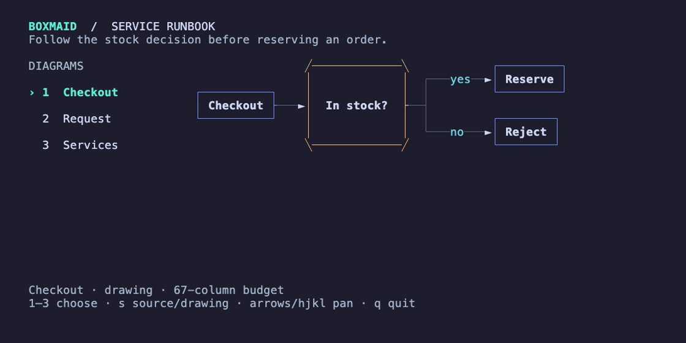
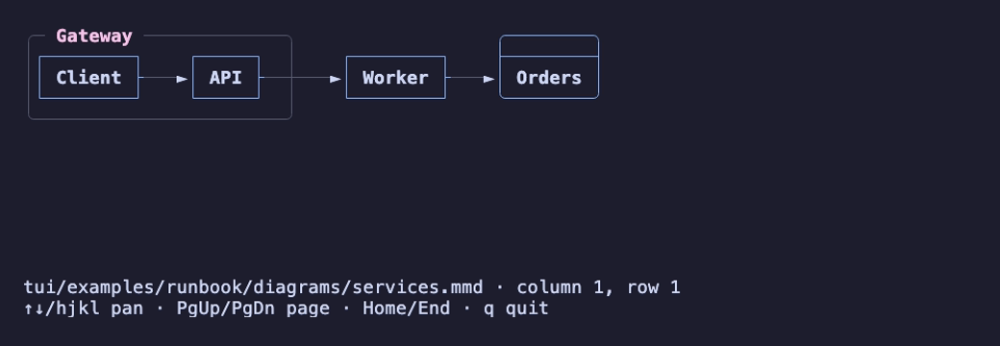

# How can I keep Mermaid diagrams inside a terminal runbook?

The runnable service-runbook example puts Boxmaid inside a real Bubble Tea application: a diagram selector, a width-aware drawing pane, a Mermaid source view, and a status/help footer.



[Static screenshot](assets/runbook.png) · [Source-view screenshot](assets/runbook-source.png) · [Complete example](../tui/examples/runbook/main.go)

## How do I run it?

Clone the repository and run the example from its root with Go 1.24+:

```sh
git clone https://github.com/rickthegreatest/boxmaid.git
cd boxmaid
go run ./tui/examples/runbook
```

| Key | Action |
|---|---|
| `1`, `2`, `3` | Choose checkout, request, or services |
| `s` | Toggle the original Mermaid source and drawing |
| Arrows / `hjkl` | Pan the drawing |
| `PgUp`, `PgDn`, `Home`, `End` | Navigate larger drawings |
| `q`, `Esc`, `Ctrl+C` | Quit |

The examples are embedded synthetic data. They do not connect to a real service, require credentials, or execute anything described by the diagrams.

## Which integration points do I need?

The application owns the selected source and viewport size. Boxmaid owns parsing, layout, drawing, and the diagram's panning state:

```go
diagram := tui.New(src)
diagram.SetSize(width, height)
diagram.SetSource(nextSource)       // e.g. when changing runbook sections
diagram, cmd = diagram.Update(msg) // forward keys/mouse events
view := diagram.View()
```

The containing app handles its own quit keys and calls `SetSize` when layout changes. The [example](../tui/examples/runbook/main.go) collapses its navigation sidebar below 76 columns and reserves space for its header/footer. This adapter targets Bubble Tea v1.

## What does the Ratatui integration look like?

The Rust crate provides a `Widget` implementation through its optional `ratatui` feature (Ratatui 0.29). This is an actual capture of the runnable Rust viewer displaying the same services diagram:



```sh
cargo run --locked --manifest-path rust/Cargo.toml \
  --example ratatui_viewer --features ratatui \
  -- tui/examples/runbook/diagrams/services.mmd
```

Use `Diagram::new(&picture).theme(...).scroll(x, y)` in your own frame. Re-render the source when the available width changes. See the [Rust example](../rust/examples/ratatui_viewer.rs) and [widget API](https://docs.rs/boxmaid/latest/boxmaid/struct.Diagram.html).

## How were the recordings made?

The screenshots and GIFs record the applications themselves with [VHS](https://github.com/charmbracelet/vhs). They are not manually drawn UI mockups. With VHS, ttyd, ffmpeg, and a Chromium browser installed, run from the repository root:

```sh
go test ./tui/examples/runbook
cargo build --locked --manifest-path rust/Cargo.toml --example ratatui_viewer --features ratatui
vhs docs/demos/runbook.tape
vhs docs/demos/ratatui.tape
```

The tape files hide compilation and shell setup; the recordings show diagram selection and source toggling. Captured colours come from the recording terminal and adapter themes. See [syntax coverage](syntax.md) before relying on a particular Mermaid construct.
